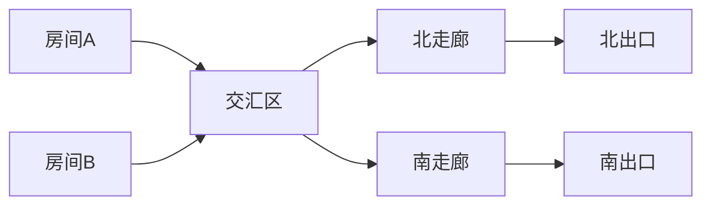
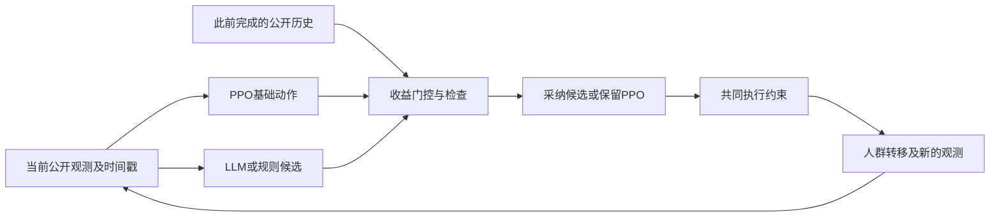

# LLM辅助火灾疏散控制的有效性与失效机制研究

**可讨论初稿，2026年10月11日。** 本文聚焦已有高层建议控制实验和最新缓存诊断，不预设方法优越性。作者、单位及目标期刊待确定；历史实验的完整版本配置见各自冻结记录，不以本轮环境描述覆盖旧版本。

## 摘要

大语言模型可为疏散控制提供出口方向、等待和分流建议，但建议可执行不意味着它优于既有控制器。本文在一个五分区、两出口的简化火灾疏散环境中，研究高层建议覆盖PPO控制的收益及失效机制。系统以时间戳区分建议生成与接收时刻，并对PPO与候选动作施加共同的出口、放行容量和指示保持约束。已有公平对照尚未建立LLM候选的稳定额外收益；最近再次覆盖实验包含2,080个完整回合和2,480条终点反事实，在即时24个再次建议机会中发现13个有害、5个有益、6个收益微小或中性，原有两种门控均全部拒绝。为检验公开人群响应能否改善选择，本文重新审计248条缓存机会，采用持续建议共同路径去重后的72个状态、20个人口家族、5个同图参数场景，固定比较当前观测、普通公开历史和响应表示。普通历史与响应方案共享全部原始历史传感字段，以完整场景留出，并按人口家族隔离拟合和经验校准。响应表示的FED收益预测MAE为0.009427，高于常数基线的0.007154；失能率差预测MAE为1.0539个百分点，高于常数基线的0.7446个百分点。其经验余量门控接受10个建议，其中7个有害、3个微小或中性，没有接受有益建议。同观测收益反转病例在加入三步支路流量后仍具有完全相同输入。结果表明，在此候选集合、早期观测窗口及有限开发数据下，未建立可靠建议收益识别，也未建立值得扩大该分支预算的证据。本文给出动作执行、公平对照、信息可得性及接受／拒绝取舍的可复核诊断流程；结论限于当前简化模拟器，不构成真实建筑安全验证。

关键词：火灾疏散；大语言模型；PPO；建议收益；公开观测；反事实诊断；失效机制。

## 1. 引言

在火灾疏散中，低烟气路线可能同时具有低出口吞吐能力；临时封闭可能使短暂等待优于立即绕行；建议到达前的人群分布也可能已经改变。控制系统必须同时考虑方向、放行容量和动作时机。LLM能够把预测和场景描述转换成高层方案，PPO能够根据观测进行连续决策，但二者组合后仍需回答一个具体问题：在当前状态下，是否值得让这条建议替换PPO本来要执行的动作？

本文把“生成建议”“满足执行约束”和“改善终点结果”分开评价。建议即使通过格式、出口状态和容量检查，也可能增加最终烟气暴露；PPO即使形成闭环，也不能默认能够纠正任何错误高层目标。全部回退到PPO能降低建议造成的风险，却不说明门控知道哪些建议有益。因此，判断门控有效性必须同时报告有害接受、有害拦截、有益接受及有益误拒。

本项目最初还探索了LLM作为疏散者行为模型的可行性。这一路线涉及对真人选择的拟合与验证，与本文的LLM建议者角色不同。当前控制实验采用模拟人群行为，未将公开真人选择验证接入该控制环境；本文不将两条证据链合并为“LLM已经准确模拟真人疏散”。

本文的工作定位为当前设置下的效果审计和机制分析：建立共同执行约束及明确的覆盖定义；用同状态配对终点模拟识别建议收益；审计重复路径、观测可得性及历史特征；在固定预算下检验响应表示是否改善留出预测。以上属于本项目已经完成的方法和证据整理，是否构成目标期刊所需的新颖贡献仍待进一步核查。

## 2. 相关工作与研究定位

LLM用于疏散研究有不同角色。FLARE结合行为理论、LLM推理与基于记忆的强化学习，研究野火后的个人撤离决策预测，并在调查数据上评价。它的预测任务与本文的室内指示和放行控制不同，不能把其中的“RL”直接等同于本文PPO执行器，也不能跨任务比较性能。[Chen等，ACL 2025](https://aclanthology.org/2025.acl-long.1438/)

另有研究将LLM作为个体决策核心，结合环境观测、人格和决策历史模拟灾害疏散。这表明“LLM＋疏散”的组合名称本身不足以构成创新；行为模拟与控制建议仍需分别验证。此处仅据出版方摘要界定任务，未重新复核其完整实验及效果主张。[Yang等，Reliability Engineering & System Safety](https://www.sciencedirect.com/science/article/abs/pii/S0951832025012554)

PPO是一类基于策略梯度的强化学习方法，通过与环境交互采集数据并优化代理目标；本文复用既有PPO权重，在最新诊断中不重新训练PPO。使用PPO并不自动获得安全或最优策略保证。[Schulman等，2017](https://arxiv.org/abs/1707.06347)

强化学习结果在训练重复较少时存在统计不确定性，不能只凭均值排名。本文沿用分组结果和区间报告，并进一步区分建筑／参数场景、人口家族、权重、状态和随机未来，避免将大量轨迹数解释为大量独立实验单位。[Agarwal等，NeurIPS 2021](https://arxiv.org/abs/2108.13264)

本次只做了以上定向核对，不是系统综述，也没有确立“首次提出”或所有相邻方法均不存在的结论。

## 3. 系统与任务

### 3.1 图环境和终点指标

最新机制与缓存诊断使用同一个五区图：两个起始房间连接公共交汇区，交汇区连接北、南走廊，走廊分别通往两个出口。初始240人，每步5秒，最多120步。该环境描述区域人数转移与通行容量，不生成已校核的真实平面坐标或连续行人轨迹。

烟气危险采用合成的每步FED增量。人群先累积所在区域危险；达到当前模拟阈值FED=1时失能。之后原走廊人员退出、交汇区人员选择走廊、房间人员按放行容量进入交汇区。本文的FED是该简化仿真的累计暴露代价，尚未经真实烟气或FDS转换校核。

主要终点为失能率、平均累计FED，辅助终点为成功疏散率、累计拥堵和回合终止时间。回合可能因为所有剩余人员失能而结束，终止时间不能一律称为全员成功疏散时间；全员成功时间仅对全部成功退出的回合定义。

### 3.2 动作、控制器与执行约束

动作空间包含九个绝对动作：北、南方向分别配合25%、50%、75%、100%房间放行档位，以及零房间放行的等待动作。等待并不意味着走廊或交汇区所有人停止移动。指示具有保持时间；PPO请求动作、约束后动作及实际方向／放行量分别记录，避免将“建议过”解释为“执行过”。

控制流程如下：

约束包括出口可用性、允许方向、放行容量和指示保持时间。约束同样施加于PPO，不假定PPO总能纠错。建议记录观测时间和到达时间，接收时重新检查当前状态；即时和实测到达延迟均使用已有Qwen3 14B缓存回放，没有在每个控制步实时重新调用LLM。

最新方向机制候选保留PPO当前放行档位，仅修改合法方向。因此本轮收益标签回答的是这个具体方向覆盖是否值得，而不是任意候选计划、等待时长或连续分流的全局最优收益。

### 3.3 人群和五个参数场景

最新完整实验采用规则行为和概率Logit行为两种模型，五套既有PPO权重601—605。模型名称中的calibrated_logit不能理解为本轮控制人群已经由真实火灾逐人数据充分校准；当前控制参数标记为合成示范设定。公开真人出口选择验证属于独立实验链。

| 参数场景 | 火源预测方向 | 北／南出口容量（人／步） | 本轮实际机制 |
|---|---|---|---|
| AULL0010 | 南 | 3／9 | 低烟气侧吞吐较低、可能拥堵 |
| AULL0013 | 北 | 8／6 | 无实际出口封闭 |
| AULL0019 | 南 | 6／6 | 无实际出口封闭 |
| AULL0020 | 南 | 7／7；北前3步为0 | 短时封闭后恢复 |
| AULL0024 | 北 | 10／3 | 容量不对称；虽然旧类别标签为compound，本参数没有实际封闭或预测错误 |

以上是一个图的五组参数，不能称五栋建筑，也没有覆盖所有历史冲突类型。

## 4. 评价方法

### 4.1 三条证据链及公平性

本文区分历史独立训练公平对照、最新完整回合机制实验、最新缓存预测诊断。不同版本的结果不直接相加或跨轮排名。

历史公平对照在相应轮次中控制九动作、基础信息与训练预算，比较独立训练纯PPO、规则建议PPO和LLM建议PPO。最近的no_advice则是在同一既有权重中去除建议输入的消融，并非本轮新训练的独立纯PPO。该区别决定了哪些结果可以说明LLM的额外作用。

反事实教师能从同一状态模拟多个动作至终点，以帮助分析候选库和收益机会；它可以访问恢复状态和未来模拟，计算预算也不同，不能将教师效果等同于可部署LLM或学生效果。

### 4.2 同状态配对收益

记决策状态为s，PPO基础动作为b，高层候选为c，共同后续控制器为π，配对随机未来为ξ。两项目标定义为：

\[
\Delta I(s,c)=\frac{1}{K}\sum_{k=1}^{K}\left[I(s,c,\pi,\xi_k)-I(s,b,\pi,\xi_k)\right],
\]

\[
\Delta F(s,c)=\frac{1}{K}\sum_{k=1}^{K}\left[F(s,c,\pi,\xi_k)-F(s,b,\pi,\xi_k)\right].
\]

I为终点失能率，F为平均累计FED；负差表示候选更好。两支先强制一个动作，再使用共同无建议PPO到终点；概率行为K=4，规则行为K=1。有限未来标签包含抽样不确定性，不能当作现实逐病例真值。未来副本只增加同状态估计信息，不增加独立场景数。

类别按此前固定容差0.001及失能优先顺序定义：失能差≤−0.001为有益，≥+0.001为有害；其余再按FED差≤−0.001或≥+0.001判断，剩余为微小／中性。门控另要求预测的不利失能差不增加，不能用FED收益掩盖预测失能上升。

### 4.3 去重、公开历史和表示比较

原缓存包含248条建议机会。按相同人口、行为、权重、时刻、动作、完成路径、观测及公开记忆合并副本；身份只离线归组，不作为在线特征。主比较使用持续建议preserve_always共同路径，88条机会合并为72个状态；全部父路径合并后80个状态只作审计。

三种表示共用当前34维观测、基础／候选动作编码及过去建议／覆盖计数，清空旧建议坐标28—32。普通历史进一步读取最多三步已完成的原始公开传感记录及简单历史摘要；响应表示在相同输入后增加17项流量、跟随方向比例、队列清空及吞吐摘要。维数分别54、170、187。支路流量同时提供给普通历史，避免把传感信息增加误写为响应表示改进。

在线输入排除场景、人口、行为和权重编号、隐藏个体属性、累计个体FED及未来结果。完成历史只包括严格早于当前决策的步骤，不读取当前动作完成后的流量。出口人数推断仅在当前模拟假设下，公开烟气累计上界能排除失能时启用；它不是现实中的安全保证。方向跟随比例受通道容量影响，不作因果服从率解释。

### 4.4 固定预测器、分组和经验余量

采用标准化双目标岭回归，alpha=1，无超参数搜索。每个人口家族总拟合权重为1。完整留出一个参数场景：该场景四个人口家族用于留出；其他场景重复0—2共12家族拟合，重复3共4家族经验校准。行为、权重、时间和未来副本不跨组。均值、标准化和常数基线仅使用拟合部分。

记两项预测为\(\widehat{\Delta}_j\)，经验余量为\(m_j\)。余量取校准家族内最大不利残差，再取家族间0.9经验分位并截断为非负。每折只有4校准家族，该经验分位实际上是所观测最大值，不具有90%的新场景覆盖保证。门控接受条件为：

\[
\widehat{\Delta}_I+m_I\leq 0,\quad
\left(\widehat{\Delta}_I+m_I\leq-0.001\right)
\ \lor\ \left(\widehat{\Delta}_F+m_F\leq-0.001\right).
\]

实现以1e−12作为失能零边界数值容差。无余量接受规则仅作诊断；不据留出结果切换方法。

报告人口家族等权MAE、预测−标签偏差、经验不利残差覆盖、接受／拒绝分类及任意均值失能增加。常数预测、无建议／全部拒绝和仅首次覆盖作简单对照。对响应相对其他表示的误差差，使用固定留出预测的场景内人口家族配对重采样2000次；这是条件性描述区间，未包含重新拟合不确定性。

### 4.5 研究收敛标准

拟合前冻结继续条件：响应方案对普通历史和常数的总体FED MAE均至少下降0.001，各有至少3个场景改善，失能MAE不变差，不接受均值有害或失能增加建议，并在至少2场景和2权重接受有益建议。此标准用于判断是否值得开展一次另行冻结的新人口确认，不是现场风险认证。

## 5. 结果

### 5.1 已有控制效果没有建立稳定LLM优势

| 已完成对照 | 候选−对照失能率差，百分点 | 原报告区间 | 解释 |
|---|---:|---|---|
| 第一轮LLM建议PPO−独立纯PPO | +1.34 | [+0.67,+2.10] | 当时版本出现退化 |
| 第二轮护栏LLM−独立纯PPO | +1.02 | [−1.57,+4.55] | 未建立稳定优势或等效 |
| 同控制器LLM候选−规则候选 | +0.237847 | [−0.085077,+0.597305] | 原冻结改善信号未通过 |
| 离线特权worst3教师−PPO601 | −0.25752 | [−0.57006,−0.03183]，探索性 | 有限开发库存在规划机会，不能作为LLM实际效果 |

表内来自不同版本、场景及计算条件，不作直接方法排序。数字及版本出处见[历史整合报告第38章](C:/Users/摩天轮大盗/Documents/ChatGPT/LLM探索/reports/LLM_RL火灾疏散研究全程整合报告_2026-10-08.md)；投稿前应将每个冻结配置及其原始汇总表并入补充材料。本文不把全部探索性轮次合并为确认性结论。

### 5.2 再次覆盖门控存在明显误拒

最近完整实验运行2,080回合、2,480条终点反事实，记录248个机会、102,632控制步。它包括五个同图参数场景、两种模拟行为、五套既有PPO权重，以及即时和实测延迟缓存模式。即时24个再次机会中，13有害、5有益、6微小／中性；仅首次覆盖和原公开查表门控均拒绝全部再次机会。它们拦截13个有害，也错过5个有益，不能称准确判断收益。延迟模式没有再次机会，对该条件的再次覆盖识别无分母可评价。

原公开门控的少量实际改善集中于单场景、单权重、规则行为子组；即时／延迟重用相同人口不能计为独立成功重复。详情见[最近独立审计](C:/Users/摩天轮大盗/Documents/ChatGPT/LLM探索/reports/再次覆盖PPO_结果解释与独立审计_2026-10-07.md)。

### 5.3 新增响应表示仍无法拆开已知反转对

最新主样本72状态、20家族，21有益、23有害、28微小／中性。24状态位于第0步、48位于第3步；产生机会的权重只有602、604、605，不能将原完整实验的五权重称为此样本的五权重支持。当前表示47个不同特征单元，普通历史和响应均48个；完整公开历史有3个同时含有益和有害标签的单元。

AULL0019、权重604、第15秒的两个病例具有完全相同当前观测和三步公开历史，流量均为[0,0]、[6,3]、[6,3]；全部响应特征也一致。概率行为人口1497101301候选−PPO FED为+0.001212877177，规则行为人口1497101302为−0.009771520627，失能差均0。确定性表示不能让这对输入分离，模型只能预测某种平均值及不确定性；有限未来的反转不等于证明一切新增传感器都无价值。

### 5.4 固定留出预测没有超过简单基线

| 表示 | 失能MAE，百分点 | FED MAE | 失能偏差，百分点 | FED偏差 |
|---|---:|---:|---:|---:|
| 当前观测 | 0.9420 | 0.009638 | +0.3208 | +0.001339 |
| 普通历史 | 1.0413 | 0.009769 | +0.2827 | +0.002066 |
| 响应表示 | 1.0539 | 0.009427 | +0.2695 | +0.002013 |
| 常数预测 | 0.7446 | 0.007154 | +0.0198 | −0.000549 |

图1柱为20人口家族等权留出MAE，点为五个同图场景的留出误差；场景点是差异展示，不是五个独立建筑或置信区间。失能率差以百分点、FED以无量纲单位分别显示。

响应相对普通历史的FED MAE下降0.000342，条件性95%重采样区间[−0.000036,+0.000692]；失能误差增大0.01269个百分点。响应FED误差在4个场景略低于普通历史，在全部5个场景均高于常数。相对常数，响应失能MAE增大0.30929个百分点，FED MAE增大0.002273。单看略降FED误差不足以证明可靠建议选择。

### 5.5 新响应门控接受有害，仍错过全部有益

| 门控／诊断 | 接受有益 | 接受有害 | 接受微小／中性 | 拒绝有益 | 拒绝有害 |
|---|---:|---:|---:|---:|---:|
| 当前观测＋经验余量 | 5 | 7 | 1 | 16 | 16 |
| 普通历史＋经验余量 | 0 | 3 | 3 | 21 | 20 |
| 响应表示＋经验余量 | 0 | 7 | 3 | 21 | 16 |
| 常数＋经验余量／全部拒绝 | 0 | 0 | 0 | 21 | 23 |
| 仅首次覆盖 | 16 | 10 | 22 | 5 | 13 |

图2以72个相同机会的均值反事实标签计数。响应接受10次，7次有害、3次微小／中性，其中5次增加均值失能率；7个接受的再次机会全部有害。全部21个有益机会均被拒绝。无余量响应门控接受40次，其中10有益、14有害、16微小／中性，不能据此改称有效方案。

响应经验不利余量对失能的家族最差残差覆盖仅55%，FED覆盖90%；对应家族内状态加权覆盖80%和约96.7%。这些是有限留出数据中针对均值标签的经验比例，既非概率校准保证，也非对每个未来或新建筑的安全保证。

采用或拒绝某一步的反事实差只能说明局部选择结果。新门控没有重新运行完整回合，不能将多个已存状态上的局部差相加后宣称为新策略完整疏散效果。完整闭环确认属于条件性下一阶段；因继续标准未通过，本轮没有启动。

### 5.6 执行审计与停止决定

本轮运行15次固定岭回归和5次常数拟合，保存288条留出预测，没有新PPO训练、LLM请求或疏散模拟。9项必要代码检查通过；保存参数预测、门控规则、人口家族权重、分组和统计分母独立重算匹配；275个保护的历史文件及冻结来源哈希保持一致。48个保留最终场景未读取。

冻结的7项继续条件全部未通过。因此停止扩大当前响应表示＋固定岭回归收益门控分支，保留负结果，不再用同一留出结果搜索特征、阈值或模型。详见[本轮执行报告](C:/Users/摩天轮大盗/Documents/ChatGPT/LLM探索/reports/缓存审计与响应收益比较_收敛执行报告_2026-10-11.md)。

## 6. 讨论

### 6.1 从“有建议”到“值得接受”还有一段距离

已有实验显示，方向、容量和时机分别产生影响。选择预计烟气较低出口，可能因该侧吞吐较低而增加滞留和暴露；保留PPO放行档位可以排除一次同时改变容量的混杂，却仍不能保证方向覆盖有益。第一次建议的收益不能直接沿用到再次建议，同一高层偏好在不同局部状态下可能产生相反结果。

因此，在线系统需要对具体候选和当前状态做判断。LLM自报置信度、建议语义正确或PPO闭环能力，均不能替代这项证据。本文的统一动作约束是执行层必要条件，终点效益另需评价。

### 6.2 不能把失败只解释为模型太小

该缓存最多观察三步响应，有效样本是20家族；每折36—48个拟合状态面对170或187维表示。尽管使用固定岭回归，相关特征、有限样本和场景变化仍可能导致不可靠外推。新的响应摘要没有拆开更多公开输入单元，已知反转对也完全一致。以上限制并不通过换一个更大的LLM、增加PPO训练或重复同一批缓存自动解决。

同时，响应相对普通历史在部分场景降低FED误差，说明“没有新增信息”不能简单推导出“表示无用”。有限预测器可能从适当表示受益。本文的否定结论针对固定窗口、预测器、候选及数据划分；未比较所有历史表示或所有合法传感器。

### 6.3 校准的取舍与指标的局限

经验余量限制了接受数量，但不能在场景变化时保证正确覆盖。当前响应门控既接受有害建议又误拒有益建议；问题因此超出单纯过度保守。常数门控全拒绝能减少候选风险，却没有识别收益；当前观测门控接受部分有益也接受有害，不能仅凭某项净平均差认定它可靠。

均值MAE、分类准确率、覆盖比例和完整闭环效果回答不同问题。尤其需要检查失能差，不能因FED误差略降掩盖有害接受。本轮只对有限配对未来均值判断，个别均值有益动作仍可能在某个未来有害；对真实新分布没有风险保证。

### 6.4 研究价值和边界

本研究可支持的价值是：提供可复核的动作链和共同约束、区分独立纯PPO与同权重消融、避免轨迹副本扩大独立样本数、分析观测相同而收益相反的具体病例，以及将有害拦截和有益误拒同时纳入建议评价。这些结果有助于避免将格式正确、零约束违规或离线教师优势误写为LLM控制收益。

它尚不支持真实建筑效果、真人行为真实性、稳定LLM额外增益或高层建议可安全部署的主张。当前负结果也不能推广为所有LLM无效；研究贡献及发表可能性仍需结合目标领域文献和真实场景证据评价。

## 7. 局限性

1. 当前五个参数场景共用一张图，早期建议样本不覆盖更长历史、全部五权重或全部冲突类别。
2. 人群、烟气与区域转移简化，未接入真实楼层校核、FDS危险转换或连续行人轨迹外部验证。
3. 决策机会由既有父策略与候选生成机制选择，未观察所有状态或所有候选计划收益。
4. 同人口规则／概率行为并非两个独立人口；随机未来副本、权重及时间步也非独立建筑样本。
5. 每折只有四个经验校准家族；本轮留出缓存已在此前研究中使用，属于开发诊断而非新盲测。
6. 本轮未采集新LLM响应，不涉及LLM调用随机性或新提示迁移；14B缓存效果不能当作27B效果。
7. 响应门控完整闭环效果未运行；只从配对局部终点差推断选择取舍。
8. 历史多轮探索带来选择与多重比较风险；本文保留版本和负结果，不把事后方法包装为首次冻结的最终方法。

## 8. 结论

在当前简化火灾疏散环境中，LLM高层建议与PPO控制结合尚未显示稳定额外收益。公开响应表示的固定场景留出比较没有超过常数基线，经验余量门控未接受有益建议，却接受了有害建议；新增三步流量也未拆开已知收益反转输入。依据拟合前冻结的资源分配标准，本文停止扩大当前收益门控分支，将已有证据收敛为有效性审计和失效机制研究。后续重新开展方法改进需要先明确能够改变可观测信息或评价设置的假设，并在独立冻结协议下验证。

## 数据、代码与补充材料说明

- [一页研究问题与角色／证据](C:/Users/摩天轮大盗/Documents/ChatGPT/LLM探索/reports/研究主线与证据一页说明_2026-10-11.md)。
- [冻结比较协议](C:/Users/摩天轮大盗/Documents/ChatGPT/LLM探索/outputs/research_convergence_20261011/frozen_comparison_protocol.json)。
- [72个主分析状态、特征和配对未来](C:/Users/摩天轮大盗/Documents/ChatGPT/LLM探索/outputs/research_convergence_20261011/primary_rows.json)。
- [全部比较结果](C:/Users/摩天轮大盗/Documents/ChatGPT/LLM探索/outputs/research_convergence_20261011/comparison_summary.json)、[留出预测CSV](C:/Users/摩天轮大盗/Documents/ChatGPT/LLM探索/outputs/research_convergence_20261011/held_out_predictions.csv)、[复核结果](C:/Users/摩天轮大盗/Documents/ChatGPT/LLM探索/outputs/research_convergence_20261011/verification.json)。
- [公开表示与预测模块](C:/Users/摩天轮大盗/Documents/ChatGPT/LLM探索/src/fire_evac/crowd_response_comparison.py)、[缓存审计脚本](C:/Users/摩天轮大盗/Documents/ChatGPT/LLM探索/scripts/audit_crowd_response_cache.py)、[固定比较脚本](C:/Users/摩天轮大盗/Documents/ChatGPT/LLM探索/scripts/compare_crowd_response_representations.py)。
- [全程历史报告](C:/Users/摩天轮大盗/Documents/ChatGPT/LLM探索/reports/LLM_RL火灾疏散研究全程整合报告_2026-10-08.md)：其他探索进入补充材料，不能与本文主分析混作同一冻结实验。

当前资料保存于本地，未公开上传。初稿已有完整的研究问题、方法、结果和讨论；投稿前仍需补齐目标期刊要求、历史实验原配置附件、领域相关工作及外部验证边界核查。
