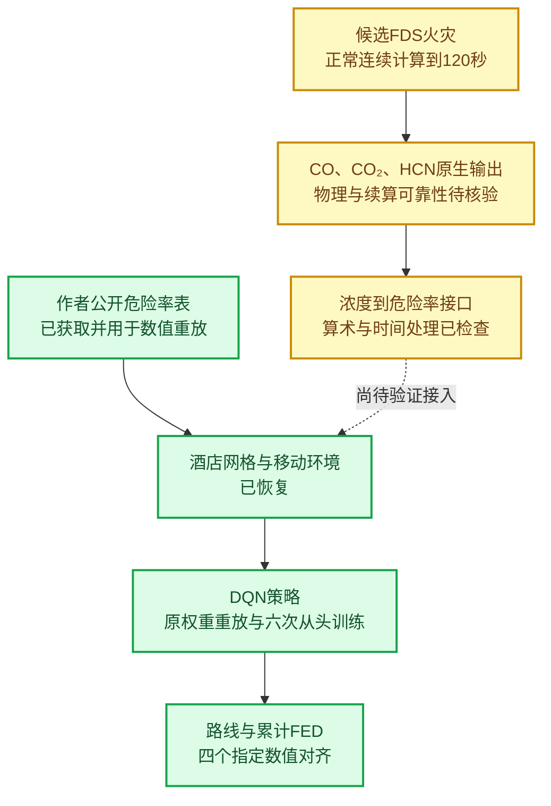

# SafeStep酒店案例复现：已完成结果与当前边界

_组会汇报稿｜截至2026年10月17日｜正文建议汇报8—10分钟，附五分钟口头稿与答疑_

---

## 🎯 1. 本次汇报的主要结论

目前已经完成酒店案例的**关键数值重放**和**公开训练程序的有限重复**：四条指定路线的FED与论文精度一致，作者保存权重能够恢复两条推荐路线；六次从头训练均能从全部61个非出口起点到达出口，但推荐路线的恢复存在种子差异。

上游火灾部分已建立并运行候选模型到120秒，尚未完成作者原始物理火灾的复现。最新检查发现酒店断点续算的烟气、温度与连续参考存在明显差异，修复尚未验证。

目标论文：Fang等，*Development of a tenability-based path planning model for building fire evacuations using reinforcement learning*，Journal of Building Engineering，118（2026），115132。[^paper]

论文研究的问题是：火灾中选择疏散路径时，如何降低沿途累计的烟气暴露。SafeStep使用DQN进行路径决策；我们早期开展的LLM＋PPO人群控制属于另一条研究线，本报告只统计SafeStep复现成果。

**建议开场表述：**

> 今天主要汇报酒店案例已经复现的结果。最明确的成果是四个FED数值对齐、作者权重路线恢复，以及六次从头训练的结果。火灾重建作为后续进展单独说明，目前还不能把整篇论文称为完整复现。

## 🧭 2. 复现范围与实验环境

### 2.1 论文的计算链条与当前完成位置

已完成的主要链条为：作者危险率表 → 酒店移动环境 → DQN路径 → FED复算。自建火灾产生的数据尚未用于宣称原论文路线结果再次复现。

### 2.2 酒店路径规划环境

| 项目 | 复现设置 |
|---|---|
| 地图数组 | 15×23 |
| 非出口移动格 | 61个 |
| 出口 | A、B两个 |
| 危险区域编号 | 58个，部分区域对应多个相邻格 |
| 决策动作 | 上、下、左、右 |
| 每格移动距离 | 2米 |
| 设定行走速度 | 0.3米/秒 |
| 单步耗时 | 约6.67秒 |
| 疏散开始时刻 | 起火后300秒 |
| 作者危险率表 | 5—900秒，每5秒一条，共180个有效时刻 |
| 网络结构 | 61→61→4，单隐藏层ReLU |
| 状态输入 | 当前位置的61维独热编码 |

这里评价一个路径决策对象的移动和暴露，没有显式建模多人排队、从众或引导服从行为。61个起点来自同一张地图，不能解释成61个独立建筑样本。[^methods]

### 2.3 本次使用的评价指标

- **到达性：** 是否能够到达出口。
- **路线一致性：** 是否逐格恢复论文推荐路线。
- **累计FED：** 按既定危险率与时间规则累计的烟气暴露指标。
- **行为有效性：** 是否存在非法移动或重复访问。

到达出口、恢复指定路线和取得更低FED分别评价。FED的数值对齐检验计算一致性，不直接验证真实人员的生理反应。

## 📊 3. 核心结果一：酒店关键数值与原权重路线已经恢复

### 3.1 实际做了什么

使用作者固定版本的酒店地图、危险率表与保存权重，恢复原程序的移动、取样、累计剂量和终止规则，再独立复核路线与FED。作者原始代码和权重保持不变。[^source][^replay]

### 3.2 四条指定路线的数值对照

| 路线 | 步数 | 行走时间/秒 | 论文FED | 本地复算FED | 论文四位小数精度 |
|---|---:|---:|---:|---:|---|
| 起点1→B，推荐 | 10 | 66.7 | 0.1471 | 0.147057413 | 一致 |
| 起点1→A，备选 | 4 | 26.7 | 0.1671 | 0.167083307 | 一致 |
| 起点2→B，推荐 | 19 | 126.7 | 0.2300 | 0.230021447 | 一致 |
| 起点2→A，备选 | 11 | 73.3 | 0.3230 | 0.322977072 | 一致 |

来源：四路线数值CSV与固定权重核验记录。[^routes][^replay]

其中，两条推荐路线由作者保存策略输出；两条备选路线按论文指定路径单独复算。四条路线并非模型在一次决策中同时输出的四种选择。

### 3.3 保存权重的策略检查

| 检查项 | 结果 |
|---|---:|
| 两条论文推荐路线逐格恢复 | 2/2 |
| 全部非出口起点到达 | 61/61 |
| 非法动作 | 0 |
| 重复访问 | 0 |

_图1：作者保存权重输出的两条推荐路线，以及指定路线的FED复算。蓝色路线通往B，橙色虚线为通往A的备选路线。右图的0.3虚线沿用原绘图参考，不作为本汇报已经验证的安全界限。_

### 3.4 这部分结果说明什么

在这两组指定路线中，推荐路线比备选路线走得更久，累计FED却更低。按复算值计算，两个指定配对的降幅分别约为11.99%和28.78%。这些是酒店局部路线配对的结果，不能替代论文小建筑约62%的改善，也没有证明所有可能路径中的全局最优性。[^methods]

**建议汇报表述：**

> 作者公开的酒店数据和保存权重能够恢复论文关键数值。四个FED在论文精度下全部对齐，两条推荐路线逐格一致。这为后续研究建立了可追溯的固定案例基线。

## 🧪 4. 核心结果二：六次从头训练均可到达，路线质量存在差异

### 4.1 实验设置

从随机初始化开始，实际调用作者公开训练函数，完成两组设置、每组三个种子的训练。种子固定为141、142、143，全部最终模型都保存并评价。[^training]

| 设置 | 学习率 | 出口奖励参数 | 训练安排 | 随机种子 |
|---|---:|---:|---|---|
| 公开Beta设置 | 0.01 | 0 | 最多20,000回合，使用公开早停规则 | 141、142、143 |
| 正文列出参数＋公开程序 | 0.008 | 10 | 固定12,000回合 | 141、142、143 |

出口奖励列是原程序的参数值，实际奖励继续按作者规则缩放。第二组同时改变多项设置，只表示正文参数应用于公开程序，不是完整正文伪代码复现，也不是单因素实验。

### 4.2 六次完整结果

| 设置 | 种子 | 训练回合 | 起点1：步数/FED | 起点2：步数/FED | 全起点到达 | 两推荐路线同时恢复 |
|---|---:|---:|---|---|---:|---|
| 公开Beta | 141 | 13,500 | 10 / 0.147057 | 21 / 0.275580 | 61/61 | 否 |
| 公开Beta | 142 | 11,000 | 10 / 0.147057 | 19 / 0.230021 | 61/61 | 是 |
| 公开Beta | 143 | 12,000 | 4 / 0.167083 | 19 / 0.230021 | 61/61 | 否 |
| 正文参数＋公开程序 | 141 | 12,000 | 10 / 0.147057 | 19 / 0.230021 | 61/61 | 是 |
| 正文参数＋公开程序 | 142 | 12,000 | 10 / 0.147057 | 11 / 0.322977 | 61/61 | 否 |
| 正文参数＋公开程序 | 143 | 12,000 | 10 / 0.147057 | 19 / 0.230021 | 61/61 | 是 |

来源：六次运行比较CSV及独立核验。[^training]

六次共完成72,500个回合、3,343,272个训练转移和72,500次优化更新。所有最终模型均没有非法动作或重访。

### 4.3 需要分别报告的两个结果

| 评价目标 | 公开Beta | 正文参数＋公开程序 |
|---|---:|---:|
| 每次训练后，全部61个起点可达 | 3/3次 | 3/3次 |
| 两条论文推荐路线同时恢复 | 1/3次 | 2/3次 |

例如，第二组种子142从起点2选择11步、FED约0.323的备选路线，而论文推荐路线为19步、FED约0.230。到达性相同，暴露指标存在差别。

这支持“公开程序能够重新学出可达策略”，也支持“存在恢复论文推荐路线的运行”；三个种子不足以估计稳定成功率或跨建筑泛化概率。

**建议汇报表述：**

> 六次从头训练都得到了全起点可达的策略，但两条论文推荐路线同时恢复的次数分别是1/3和2/3。因此，我们将到达性与路线质量分开报告，不挑选最佳种子代表全部结果。

## 🔍 5. 已完成的代码审计与训练诊断

### 5.1 公开程序与正文描述存在差异

| 项目 | 公开程序实际行为 | 正文描述重建时采用的行为 |
|---|---|---|
| 优化时机 | 每回合结束后一次更新 | 预热后每个控制步更新 |
| 损失 | 四输出MSE，并保留未选动作锚定 | 被选动作TD误差 |
| 超时转移 | 超时LOSE仍自举 | WIN、LOSE均不自举 |
| 目标网络同步 | 回合末检查步数间隔 | 每50个全局控制步同步 |

来源：固定作者代码审计与训练整合报告。[^audit][^methods]

### 5.2 后续诊断的结论边界

更接近正文流程的三个训练运行均达到事先设定的一小时上限，没有完成正式训练终点。后续更新频率、损失拆分和阶段检查点诊断，也没有形成稳定修正方案。[^methods]

因此，当前保留公开程序六次完整运行作为复现证据；修改流程的实验作为补充诊断。后者不能代替前者，也不能据此判定原论文训练必然失败。本次组会无需逐轮展开这些诊断，重点报告已识别的实现差异及尚未解决的问题。

## ⚙️ 6. 火灾上游的最新进展与限制

### 6.1 已实际完成的工程工作

| 工作 | 当前成果 |
|---|---|
| 酒店FDS候选重建 | 六网格、93,981个计算单元 |
| 区域接口 | 58个候选物理区域对应61个非出口RL格 |
| 区域气体输出 | 58处×CO、CO₂、HCN，共174路 |
| 时间与单位处理 | 原生时间戳保留、显式浓度单位转换；20项解析及失败输入检查通过 |
| 连续火灾计算 | 从零正常运行到120秒 |
| 正常断点核验 | 保存100.046秒断点，恢复到110秒并与连续参考比较 |

这些成果属于探索性重建与接口实现。精确几何、原始HCN产率、部分燃料物性和窗口实现仍未完整找回；当前HCN产率及窗口气温代理不能直接归为作者原始设置。[^physics][^time]

### 6.2 最新酒店续算没有通过一致性筛查

| 指标 | 续算相对连续参考的偏差 | 预先冻结的筛查结果 |
|---|---:|---|
| HRR累计能量相对差 | 0.13% | 通过 |
| HRR曲线最大相对差 | 3.97% | 通过 |
| 最大温度绝对差 | 215.6℃ | 未通过 |
| CO最大绝对差／参考峰值与冻结下限的较大值 | 84.9% | 未通过 |

这里HRR曲线与CO的点比较使用共同时间点插值，能量按输出区间均值重建；这些数值是数值一致性检查，不是物理安全评价。CO的84.9%也不是逐点相对误差的平均值。[^physics]

失败后追加16次秒级小模型诊断。开放模型未复现酒店的大偏差；封闭双腔中，动态连通的两个压力区在续算后发生偏离，静态连通的单压力区则接近连续结果。结合固定版本源码，证据指向压力分区合并状态的恢复，但求解器修复尚未实施验证。[^physics]

目前保留正常连续120秒轨迹作为探索基准，暂停依赖该酒店断点开展长时计算。由于模型尚未覆盖300秒疏散开始后的阶段，这批新火灾数据没有用于计算路线FED。

**建议汇报表述：**

> 上游已经从输入草案推进到实际120秒计算，并完成续算对照。但烟气与温度的一致性检查没有通过。因此，上游目前报告为重建进展，不计作原论文完整物理复现。

## 📌 7. 阶段结论与下一步

### 7.1 本次可以正式汇报的成果

1. 恢复了酒店地图、危险率读取、移动规则、DQN推理和FED累计的计算链条。
2. 四条指定路线FED在论文四位小数精度下全部吻合，作者权重两条推荐路线逐格一致。
3. 完成公开训练程序两组设置、每组三个种子的重复，全部运行全起点可达，推荐路线恢复存在差异。
4. 保存了原始资料、六个训练模型、运行日志、独立核验与可重复推理入口。

### 7.2 尚未完成的论文内容

| 内容 | 状态 |
|---|---|
| 与正文全部训练流程一致的完整终点 | 尚未完成 |
| 原作者完整FDS火灾与气体浓度序列 | 尚未恢复 |
| 用自建原始浓度恢复作者危险率并对齐FED | 尚未完成 |
| 自建火灾300—900秒的可靠计算 | 尚未完成 |
| 小建筑案例约62%的改善 | 缺对应原始数据，尚未复现 |
| 真实人群行为与跨建筑效果 | 尚未验证 |

读到了作者覆盖至900秒的危险率表，并不意味着已经自行完成900秒物理火灾计算。早期LLM＋PPO实验也不能补足上述论文复现缺口。

### 7.3 下一步的执行顺序

1. 在封闭双腔最小反例中验证压力分区连接的恢复修正，先核对压力、流动、气体和温度。
2. 修正通过后返回酒店模型，使用原冻结标准重新评价续算一致性。
3. 数值与物理输入条件满足后，再规划300秒及更长时段的探索计算；若取得原始材料，再开展严格上游数值对齐。

当前不自动扩大DQN训练或恢复LLM＋PPO训练。已有酒店路径基线继续保留，用于未来相同条件下的方法比较。

## 📝 8. 五分钟口头汇报稿

下面一段可以直接照读。时间为建议分配，不是实测讲述时长。

### 0:00—0:45　研究对象与复现目标

这次汇报的是SafeStep酒店案例复现。论文用DQN为疏散者选择路径，评价目标包括沿途累计烟气暴露。我的工作分为两部分：一部分用作者公开数据和权重复核路线数值，再从随机初始化训练；另一部分尝试补齐上游火灾模拟。今天主要汇报已经完成的下游结果，上游只作为进展说明。

### 0:45—1:45　关键数值已经对齐

酒店案例有两个论文起点、两个出口。四条指定路线的FED分别是0.1471、0.1671、0.2300和0.3230，本地复算在论文四位小数精度下全部吻合。作者保存权重输出的两条推荐路线也逐格一致，分别是10步和19步。进一步检查61个非出口起点，全部能够到达，且没有非法动作或重访。这里复现了较长路线可能具有较低累计暴露的现象，但结论限于作者给定危险率的酒店案例。

### 1:45—2:45　从头训练能够到达，但路线存在差异

从头训练做了两种设置，每种三个种子，共六次完整运行。六次都从全部61个起点到达出口；两条论文推荐路线同时恢复，公开Beta组是1/3次，正文列出参数结合公开程序组是2/3次。所以现在能够说明公开程序可以重新学出可达策略，也存在恢复论文路线的运行，但不能说所有种子都稳定得到相同的低剂量路线。全部模型都保存，没有选最好的一个代表整体结果。

### 2:45—3:30　实现差异与复现边界

代码审计发现，公开程序与正文在优化时机、损失、超时自举和目标网络同步上存在差异。更接近正文流程的完整训练尚未完成，后续有限诊断也没有得到稳定修正。这些失败实验与前面六次公开程序完整运行分别报告。当前最明确的成果仍是固定权重关键数值对齐，以及公开程序的有限种子重复。

### 3:30—4:15　火灾重建取得进展，但还未验证通过

上游目前已经建立六网格酒店候选，配置58个区域的三种气体输出，并正常连续计算到120秒。之后用正常断点恢复到110秒，与连续结果比较，虽然累计放热能量只差约0.13%，烟气和温度差异仍很大，因此续算未通过。小模型和源码证据把问题缩小到压力分区连接的恢复，修复还没有验证。所以上游不能算原论文物理复现成功。

### 4:15—5:00　阶段收获与下一步

本阶段已经形成可追溯的酒店DQN路径基线，包括四个关键FED、两条推荐路线、六个重新训练的模型及完整记录。原论文小建筑约62%的结果，以及从原始火灾到危险率再到FED的完整链条，仍未复现。下一步先用最小反例修正并验证压力分区恢复，再回到酒店模型检查；达到条件后才进入更长时段计算。

## 💬 9. 老师可能追问的问题

展开查看答疑口径

### 到底算不算复现成功？

酒店固定权重的关键数值和推荐路线已经复现，公开程序从头训练也有完整成功运行。整篇论文全部案例和上游物理链条尚未完整复现，应按模块报告。

### 只是用了作者权重，是否没有重新训练？

两类工作都完成了。固定权重重放核对论文数值，六次随机初始化训练检查公开程序能否重新学得策略，二者的证据含义分别报告。

### 61/61可达，为什么还不能说稳定复现路线？

可达性只说明最终能到出口。部分种子选择的路线FED更高，或与论文推荐路线不同。因此到达和低剂量路线恢复需要分开检查。

### 第二组为什么不称为完整正文训练复现？

第二组将正文列出的学习率、回合数和出口奖励应用于公开训练程序，优化流程仍沿用公开代码。它同时改变多项参数，也不能作为单因素因果实验。

### 为什么不把酒店结果说成论文约62%的改善？

约62%对应另一小建筑案例。酒店两组指定路线的FED配对降幅约12.0%和28.8%，建筑、输入序列和比较对象不同，不能互相替代。

### 最近续算失败，会推翻前面的FED数值吗？

前面的FED直接来自作者公开危险率表；最新续算使用我们自建的候选火灾。两条数据来源独立，续算失败限制了自建火灾的使用，不改写已经完成的作者数据数值重放结果。

### 这与老师提出的LLM模拟人、RL负责引导有什么关系？

当前成果提供了一个风险相关路径规划基线。SafeStep本身没有验证真人选择、引导接收或动态改道，也没有建立LLM人群模型。若回到该方向，需要另外定义行为任务，并用适合的数据验证LLM的价值。

---

## 🔗 10. 证据与可复用文件

### 阅读与展示

- [前期路线、训练与诊断整合报告](D:/UserFolders/Documents/ChatGPT/LLM探索/reports/SafeStep论文复现正式整合报告_2026-10-16.md)
- [最新正常120秒基准与续算核验报告](D:/UserFolders/Documents/ChatGPT/LLM探索/reports/SafeStep正常120秒酒店基准与定期断点续算核验_2026-10-17.md)
- [酒店推荐路线与四个FED的展示图](D:/UserFolders/Documents/ChatGPT/LLM探索/outputs/safestep_paper_numerics_20261015/numeric_run/hotel_numerical_reproduction.png)
- [六个最终训练模型索引](D:/UserFolders/Documents/ChatGPT/LLM探索/outputs/safestep_reproduction_package_20261016/trained_model_index.csv)
- [基线使用说明与重复推理入口](D:/UserFolders/Documents/ChatGPT/LLM探索/outputs/safestep_reproduction_package_20261016/README.md)

### 依据与数据

[^paper]: Fang等，*Development of a tenability-based path planning model for building fire evacuations using reinforcement learning*，Journal of Building Engineering 118（2026），115132。[论文DOI](https://doi.org/10.1016/j.jobe.2025.115132)。

[^source]: [作者SafeStep_v1固定提交](https://github.com/hqfang3/SafeStep_v1/tree/573f613420e21e9a6731bc56fa36ea0b3f3a05f6)。本文依据本地归档，不声称核查了仓库最新状态。

[^methods]: [SafeStep论文复现正式整合报告：方法、结果和解释边界](D:/UserFolders/Documents/ChatGPT/LLM探索/reports/SafeStep论文复现正式整合报告_2026-10-16.md)。本次组会文件基于已有记录整理，没有新增训练。

[^routes]: [四条固定路线数值CSV](D:/UserFolders/Documents/ChatGPT/LLM探索/outputs/safestep_paper_numerics_20261015/numeric_run/fixed_route_comparison.csv)。

[^replay]: [固定权重重放核验JSON](D:/UserFolders/Documents/ChatGPT/LLM探索/outputs/safestep_reproduction_package_20261016/baseline_replay/verification.json)。

[^training]: [六次从头训练比较CSV](D:/UserFolders/Documents/ChatGPT/LLM探索/outputs/safestep_author_training_20261015_v2/six_run_comparison.csv)；[六次训练报告与独立检查说明](D:/UserFolders/Documents/ChatGPT/LLM探索/reports/SafeStep从头训练复现_双设置三种子结果_2026-10-15.md)。

[^audit]: [作者训练源码审计JSON](D:/UserFolders/Documents/ChatGPT/LLM探索/outputs/safestep_author_training_20261015_v2/source_training_audit.json)。

[^physics]: [正常120秒酒店基准、配对续算及压力分区诊断报告](D:/UserFolders/Documents/ChatGPT/LLM探索/reports/SafeStep正常120秒酒店基准与定期断点续算核验_2026-10-17.md)；[完整数值与冻结筛查结果](D:/UserFolders/Documents/ChatGPT/LLM探索/outputs/safestep_clean_hotel120_20261017/analysis_results.json)；[压力分区后续诊断](D:/UserFolders/Documents/ChatGPT/LLM探索/outputs/safestep_clean_hotel120_20261017/followup_diagnosis_summary.json)。

[^time]: [原生时间处理20项核验](D:/UserFolders/Documents/ChatGPT/LLM探索/outputs/safestep_physics_time_contract_20261016/native_time_verification.json)；[参数来源与接口说明](D:/UserFolders/Documents/ChatGPT/LLM探索/reports/SafeStep物理参数来源与原生时间处理_120秒探索计算_2026-10-16.md)。
