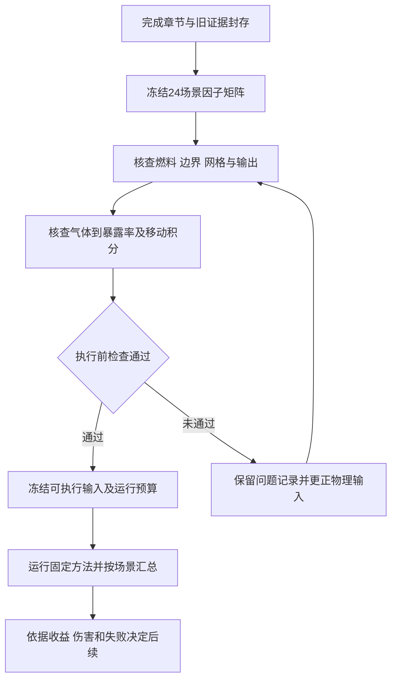

# SafeStep收尾与新建FDS场景下的规划方法检验

_结构方案v1.1，2026-10-19；文件名保留首轮入口。当前交付是复现章节、既有证据封存和24场景的结构设计。尚未运行新FDS、训练或策略评估；可执行物理输入和暴露转换仍有明确待核查项。_

---

## 📋 1 这一步完成什么

本阶段把已完成的SafeStep工作整理为一个可追溯的复现与方法审计章节，同时建立脱离其公开FER表的新场景设计。后续问题限定为：在同样的已送达观测下，趋势预测及既有门控能否在新的火灾仿真序列上改善单代理路线的累计暴露，并控制有害改道。

原先建议中的完整因子数应为`2×3×2×2＝24`，不再模糊写成12至24个。24表示因子覆盖预算，没有经过统计功效计算，不代表24个案例足以支持普遍泛化。

| 交付 | 本次状态 | 使用方式 |
|---|---|---|
| [论文章节v1](SafeStep复现与预测门控审计_论文章节_v1_2026-10-19.md) | 已完成内部草稿 | 作者核读后并入论文 |
| [结构化方案](../schemas/post_safestep_physical_design_20261019.json) | 因子、观测、方法与评价规则固定 | 供程序生成矩阵与检查 |
| [24场景矩阵](../outputs/safestep_closure_plan_20261019/scenario_matrix.csv) | 程序生成并冻结顺序 | 后续逐例准备物理输入 |
| [既有证据哈希](../outputs/safestep_closure_plan_20261019/source_hashes.json) | 按历史清单核查并封存引用 | 检测旧材料是否变化 |
| [结构检查结果](../outputs/safestep_closure_plan_20261019/design_validation_reviewed.json) | 因子平衡与抽象连通性检查 | 不能代替FDS或物理验证 |

新FDS序列属于另一组数值案例。它们可用于检查方法是否只适用于SafeStep的一张图和一条原始危险率，但同一求解器生成的数据仍有共同模型假设，不能称为独立真实火灾实验验证。NIST提供的求解器、核查案例与实验验证资料也分别承担不同的证据角色。[^1][^2]

## 📚 2 SafeStep章节与封存决定

新章节以“公开火灾危险率下的疏散路径规划复现与预测门控审计”为题，整合基础对照、五例差额、历史预测反例、合成门控确认以及讨论。它保留正面结果和失败证据，也明确两个阶段的快照含义：早期基准读取理想当前危险率，后续实验只保持最新已送达的原生采样。每个阶段在自身共同口径内比较，不跨阶段表格计算方法增益。

章节保留的中心结论是：门控较未经门控的预测减轻了损失，但切换门槛相对快照仅降低平均FED约0.0133259%；指定事后重加权中，脉冲总体权重由42.8571%提高至46.0196%时优势归零。数值可复算与现实安全收益、跨环境有效性是不同层次的判断。

封存不采用覆盖或删除。旧代码、输入、轨迹、汇总和报告保留原样，新章节另存v1；脚本依据历史哈希清单在本次生成前后检查同一组文件。新封存清单记录本次章节、方案和矩阵的哈希。它固定的是这些版本，发现错误时应另建更正版本并说明，不把错误永久保留为事实。

已有300秒案例、五例偏差和合成确认缓存均已参与开发或审计。它们继续作为旧证据保留，不重新称为新方案的未见测试。既有人群研究的48个最终场景仍封存。

## 🎯 3 新研究问题与分阶段顺序

主要问题为：仅从历史原生采样预测危险率，与持有最新测量的快照规划相比，是否存在可重复的平均暴露收益；这种收益是否伴随局部伤害、折返或失败增加。先沿用已经冻结的预测与门控，避免在新场景中一边找门槛一边报告确认收益。

本轮不提出新的LLM或RL算法。若普通预测已不能兑现稳定收益，下一轮需要明确新增模型能改善何种预测问题。更强方法可以从同样的信息中提取更好的预测，也可以引入可核验的新信息；两种路径都需与相同信息条件下的基线比较。

物理输入的调试只能依据几何、热释放率、原始气体、时间统计和核查算例。不得通过某个控制器的收益排名来选择燃料、墙体或网格。调整物理方案时另存版本，记录是否已经查看规划结果。

## 🧱 4 24场景的名义设计

### 4.1 完整因子矩阵

| 因子 | 水平 | 名义组合中的作用 |
|---|---|---|
| 布局 | L1直走廊及三个开敞支室；L2环形走廊 | 改变可选路径结构 |
| 火源位置 | F1、F2、F3 | 每布局固定三个绝对位置 |
| 达到峰值的时间 | G150、G300 | 分别150秒、300秒 |
| 通风 | V0无额外开窗；V1额外窗口从起火时开放 | 保持两出口状态相同 |

所有组合完整枚举，使用种子20261019冻结运行顺序。每个布局12例；每个火源位置8例；每个增长与通风水平各12例。运行顺序用于避免计算批次总与同一条件重合，不会给这些确定性仿真创造随机分组的物理因果证据。

### 4.2 几何和火源的研究者设定

L1的名义域为24×12×3米：主走廊沿x方向，y为5至7米，左右两端各一出口；三个开敞支室分别连接其下方，火源中心为(5,2.5)、(13,2.5)、(21,2.5)米。支室与走廊目前为完整开放接口，不能声称已经建模真实房门或酒店房间。

L2的名义域为24×16×3米：上下走廊及左右连接段绕过中央实体区，形成两条绕行方向；出口在(0,4)、(24,12)米；南侧连续开敞带中的三个火源中心为(6,1.5)、(12,1.5)、(18,1.5)米。三个相接矩形的并集形成一个18×3米开敞带，没有三间独立房室。所有开放矩形、出口和10个起点的绝对坐标保存在JSON中。生成器对开放区域的抽象坐标连通性作检查；这尚未证明实际FDS墙面、开口和观测点都正确。

火源目标均为1000 kW、名义燃烧面积1平方米。采用`Q(t)=min[1000,1000(t/t_peak)^2] kW`，到峰后维持；150秒和300秒为本研究选择的两种增长时间，不冠以未经核对的标准火灾等级。实际释热是否受缺氧限制需在仿真中检查，不能只以输入目标代替实际输出。

V0与V1的两个疏散出口都一直开放，只改变预定南侧空间的外窗。这样避免把“通风变化”和“出口可用性变化”捆在一个因子里。两出口名义开口宽2米、高2米；额外窗口宽2米、高1米、窗台高1.5米。以上尺寸、20℃环境温度及恒定行走速度都属于研究者设定，不是实测建筑参数。

### 4.3 尚未固定的物理内容

燃料组成、有效燃烧热、CO/HCN/烟炱产率、壁面与辐射参数尚未完成来源和适用范围核查。JSON为这些待定项保留`null`，不会把SafeStep中未恢复的参数隐式复制到新案例。特别是其他核查例中的气体产率不能当作通用材料产率。

因此，目前只称“名义设计结构冻结”。完成这些参数及版本核查后，需要另存可执行物理输入冻结记录。当前方案不能直接触发24例长计算。

## 🧪 5 物理数据与暴露计分的执行前检查

### 5.1 版本、网格和时间数据

官方固定版本指南可核对网格加密、时间函数、测点输出与FED气体单位。该资料用于明确实现约定，不能证明自建建筑已经验证。候选网格0.5、0.25、0.125米，先固定L1_F2_G150_V0及L2_F2_G150_V1作敏感性检查；0.25米仅为待检验的主网格候选。[^3]

网格比较使用实际HRR、选定观测点的温度与原始气体曲线，以及固定诊断路线的剂量，不比较策略排名来挑网格。每级还应记录实际离散开口与燃烧面积，避免几何变化混入网格差异。出口高度在评分前审阅中从2.25米改为2米，以便在三个候选网格上对齐。10%的相对变化作为研究者预设筛查目标，近零值另外报告绝对差；还需检查物理上相关的变化，不能把这个数字当成通用合格标准。若仍不稳定，先停止方法评分并记录修订。

目标物理时长900秒，原生输出1秒一次、瞬时值、采样高度1.5米，保存实际CSV时间。执行时核对输出统计与所用求解器版本，显式区分采集时间和送达时间。名义时域足以覆盖450秒最晚出发后最长300秒的路径。

### 5.2 先锁定局部暴露率，再沿路线积分

新序列保存原始CO、CO₂、O₂及实际定义的其他气体、温度、消光系数和实际HRR。气体浓度的湿/干基、摩尔分数、ppm与体积百分比必须逐项记录。主气体剂量模型的公式、活动水平、呼吸参数和秒/分钟换算，在方法评分前锁定；当前`primary_dose_definition`仍为空。

固定测点的累计FED包含该测点从起算到当前的暴露历史，不能把沿途多个测点的累计FED相加。需要从局部原始气体得到已明确单位的暴露率，再沿代理实际到达时刻的路线积分。应先通过已知浓度例和官方核查例验证这一转换，相关官方输入文件只是实现核查依据，其产率不自动适用于本研究。[^4][^5]

若气体到FER的定义仍未锁定，可以检查原始气体、温度和能见度数据质量，但不得提前发布“FED改善”。新剂量模型若与SafeStep不相同，两套绝对值也不直接比较。

### 5.3 六项执行条件

| 编号 | 必需证据 | 当前状态 |
|---|---|---|
| P1 | 本地求解器版本、可执行文件哈希及匹配指南 | 待核查 |
| P2 | 燃料、产率、壁面和辐射参数来源与假设表 | 待固定 |
| P3 | 实际几何、开口、测点与路径图检查 | 抽象连通性已查，FDS层待查 |
| P4 | 气体到暴露率的公式与单位核查 | 待锁定 |
| P5 | 两个代表例的网格、HRR、输出统计检查 | 未运行 |
| P6 | 有界试运行的时间、内存及正式输入冻结 | 未运行 |

进入正式策略评价前逐项记录结果，不把文档中勾选状态当作计算证据。官方验证案例若与当前目标和范围相关，可补充适用性检查；移植其代码不等于移植其实验验证结论。[^2]

## 🚶 6 路径、观测与对照方法

每布局固定10个非出口起点，150、300、450秒三个出发时刻。采用1米路径分辨率、0.8米/秒恒速、四邻域及到边界吸收出口的合法连接；无等待，最多240步。新图与新步长不沿用酒店DQN的位置编码，旧DQN权重不能直接迁移使用。

设干净观测和15秒延迟两种条件。两者都只接收原生已送达采样，延迟条件严格满足`采集时刻+15秒≤决策时刻`，不使用未来端点插值。两种条件来自同一物理场，是观测变体，不能计为额外独立火灾。

固定7个在线方法：最近出口、最新已送达采样快照、30秒趋势、半斜率、三模型均值、固定5%一致性门控、5%/1%/10%切换门槛；另设拥有实际未来的最小剂量参照。预测窗口、非负截断和60秒外推上限沿用旧冻结方案。每次只执行首动作，再按剩余步数重规划。

在线规划使用共同观测与动作约束，最近出口作为刻意简化的距离基线。完整未来参照拥有额外信息，门控规划计算更多，因此分别报告信息条件与计算量，不把它们混成相同计算预算的比赛。

名义上每方法共有`24×10×3×2＝1440`个配对回合，其中每种观测720个。这里没有运行这些回合；物理输入、映射或连通性若需要修订，应先改协议再评分。最多八种方法的轨迹数也不能作为新的物理样本数。

未到出口的回合先列为失败，不能因其只积累了部分剂量而算作低暴露成功。先比较到达与失败，再比较共同到达的配对剂量，同时公开共同到达的分母。模型不设置FED失能阈值，到达仍只是图上的终止条件。

## 📊 7 评价、继续条件与停止规则

对每个物理案例s与观测条件，先在共同到达的起点和出发时刻上计算

\[
R_s=\frac{\sum(F_{0}-F_m)}{\sum F_0},\qquad
R_{\mathrm{macro}}=\frac{1}{24}\sum_sR_s.
\]

主评价对24个案例等权，干净与延迟分别报告。另给平均绝对剂量差、全部配对剂量总和的相对差、逐布局与逐通风分解；后者的权重意义与场景宏平均不同，不互换使用。若某案例基线剂量总和接近零，公开绝对差和未定义的相对值，并且不宣称完整24例的继续条件已经满足。

伤害指标包括：剂量增加的路线数、配对绝对剂量增加的95分位数与最大值、折返、失败和行走时间。多起点和多时刻属于同一物理场内的嵌套对照，不开展将1440条路线视作独立样本的显著性检验。

本轮预设的工程筛查目标为：干净和15秒延迟下，场景宏平均相对快照至少降低2%；每布局12个案例的R_s等权平均均不小于零；失败总数不增加，而且新增配对失败必须为零，即快照到达而新方法失败的同一配对数为零；基线剂量不接近零的路线，最坏相对增加不超过5%。所有近零基线的绝对伤害仍保留。新增失败单列，避免不同起点间交换失败后，成功子集的均值看起来改善。这些是决定是否值得继续投入的研究者目标，未校准为临床、建筑安全或统计合格阈值。

若只出现少数成功案例或类似0.013%的微小混合均值，按不充分收益报告，不在该矩阵上继续搜门槛。即使满足上述目标，也只足以支持在这一模型族中继续检验；需要另行冻结的新来源确认，才考虑更复杂预测或训练。

如果物理参数、单位或网格检查未通过，暂停的是正式方法评分，保留失败和诊断输出，先修复数据生成与计分。不得为了获得非零或好看的控制效果而改变火灾设定。若发现需要等待或拥堵控制等新任务，另立协议，不悄悄改变当前动作空间。

## ✍️ 8 下一项具体实现

下一项是完成P1至P4：记录可用FDS版本；建立燃料、墙体、产率的来源表；生成两个布局的实际输入与路径图；用固定浓度和移动路线检查气体到剂量转换。之后才运行两个代表例的有界诊断，得到真实的耗时与网格信息，再冻结正式可执行输入。

这里不要求再次取得作者原始FDS文件。可以使用来源明确的自建参数与公开核查材料，但必须承认它们检验的是另一组模型条件。老师原先的“LLM模拟疏散者、RL引导人群”仍需行为资料支持，当前单代理仿真不承担这一结论。

## 🔗 9 来源与复查入口

本地完成记录以[审阅后清单](../outputs/safestep_closure_plan_20261019/completion_manifest_reviewed.json)为准。首次结构冻结记录仍保留，评分前审阅的四项修订见[修订说明](../outputs/safestep_closure_plan_20261019/final_review_amendment.json)；24个因子组合及顺序没有改变。该清单区分新文稿、名义矩阵、旧证据检查与尚未就绪的物理执行。作者后续核读仍需确认科学解释与参数适用性；本地文件哈希和结构检查不等于完成作者人工核验。

[^1]: NIST. [FDS与Smokeview官方入口](https://pages.nist.gov/fds-smv/)，访问日期2026-10-19。用于核对求解器研究范围。
[^2]: Firemodels. [FDS Validation Process](https://github.com/firemodels/fds/wiki/FDS-Validation-Process)，访问日期2026-10-19。用于区分案例输入、实验资料与数值输出的验证工作。
[^3]: Firemodels. [FDS 6.11.1用户指南固定源](https://github.com/firemodels/fds/blob/FDS-6.11.1/Manuals/FDS_User_Guide/FDS_User_Guide.tex)，访问日期2026-10-19。核查条目为Mesh Resolution、Time-Dependent Functions、Device Output及FED/FIC；本地可执行版本尚未由此确认。
[^4]: Firemodels. [固定版本FED_CO_HCN核查输入](https://github.com/firemodels/fds/blob/FDS-6.11.1/Verification/Species/FED_CO_HCN.fds)，访问日期2026-10-19。
[^5]: Firemodels. [固定版本FED_FIC_SMIX核查输入](https://github.com/firemodels/fds/blob/FDS-6.11.1/Verification/Species/FED_FIC_SMIX.fds)，访问日期2026-10-19。
