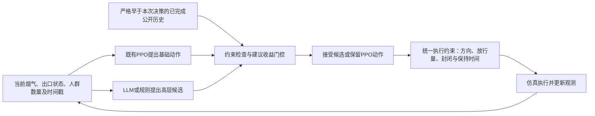

# 研究主线与证据一页说明

日期：2026年10月11日。工作题目：**LLM辅助火灾疏散控制的有效性与失效机制研究**。

## 只回答一个核心问题

在当前简化仿真里，根据决策时能看到的信息，能否判断某个具体高层建议是否值得替换已有PPO动作？如果能，再用相同门控比较规则候选与LLM候选，判断LLM是否提供额外价值。

老师最初提出的“LLM模拟疏散者、RL引导人群”，与实际后期开展的“LLM提出高层建议、PPO实施控制”是两条路线。本文聚焦后者；公开真人选择数据只提供另一路线的前期可行性证据，没有接入当前控制环境。

## 系统职责

LLM负责提案，PPO负责基础控制，规则负责统一的可执行约束，门控负责是否采纳。PPO和LLM候选都受约束；动作合法不代表最终暴露较低。新收益比较只做离线预测和影子门控，不把标签或仿真未来提供给在线控制器。

## 已有证据及其边界

| 证据 | 已完成结果 | 可支持的结论 |
|---|---|---|
| 第一轮公平对照，LLM建议PPO−独立训练纯PPO | 失能率差+1.34个百分点，区间[+0.67,+2.10] | 当时版本退化，不能宣称LLM必然改善 |
| 第二轮护栏对照 | +1.02个百分点，区间[−1.57,+4.55] | 未建立稳定优势，也未建立等效 |
| 同控制器LLM候选−规则候选 | +0.237847个百分点，区间[−0.085077,+0.597305] | 尚无LLM候选的额外收益证据 |
| 最新再次覆盖实验 | 2,080回合、2,480次终点反事实；即时24个再次覆盖机会中13有害、5有益、6微小/中性；两门控全拒绝 | 拦截与误拒同时存在，全部拒绝不能证明收益识别准确 |
| 同观测收益反转 | AULL0019第15秒，同观测及已记录控制历史，FED差一正一负 | 不能仅依赖该观测逐病例确定收益；需要审计历史流量是否提供信息 |
| 公开真人选择验证 | Qwen3 4B在Snopková任务约61.65%，频率基线约86.59% | 当前模型尚不足以充当已验证的真人行为替代品 |

以上结果来自不同版本和任务，不做跨轮排名或直接汇总。来源：[全程整合报告](C:/Users/摩天轮大盗/Documents/ChatGPT/LLM探索/reports/LLM_RL火灾疏散研究全程整合报告_2026-10-08.md)、[最近独立审计](C:/Users/摩天轮大盗/Documents/ChatGPT/LLM探索/reports/再次覆盖PPO_结果解释与独立审计_2026-10-07.md)。

## 本轮交付与停止条件

完成缓存信息审计；固定一轮当前观测、普通历史、响应表示比较；以场景留出、人口家族归组、配对未来汇总报告误差和接受/拒绝取舍；同步形成论文初稿。若响应表示未显示可重复的额外收益，或有效信息与事件数量不足，则停止扩展该分支，整理负结果及失效机制。只有通过开发标准才另行冻结一次新人口确认。

本轮复用五套PPO与Qwen3 14B缓存，不扩训练，不更换LLM，不读取48个保留最终场景。五个参数场景共用一个五分区、两出口图，不能写成五栋真实建筑验证。

## 论文目录

1. 引言：为什么需要判断建议收益，而不能默认LLM或PPO可靠。
2. 系统与任务：五区图、烟气、行为、九动作、时序和统一约束。
3. 评价方法：公平对照、已完成实验、配对反事实、分组及泄漏防范。
4. 结果：效果证据、方向/容量/时序机制、再次覆盖取舍、响应预测诊断。
5. 讨论：观测不可辨别、事件稀疏、行为真实性、外推及改进条件。
6. 结论：当前证据范围内的有效性判断；未验证事项单列。
